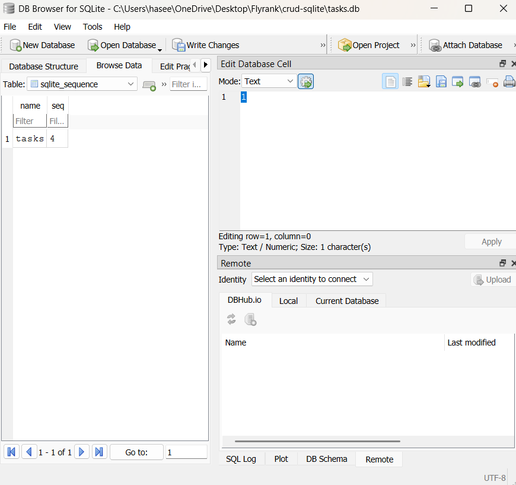
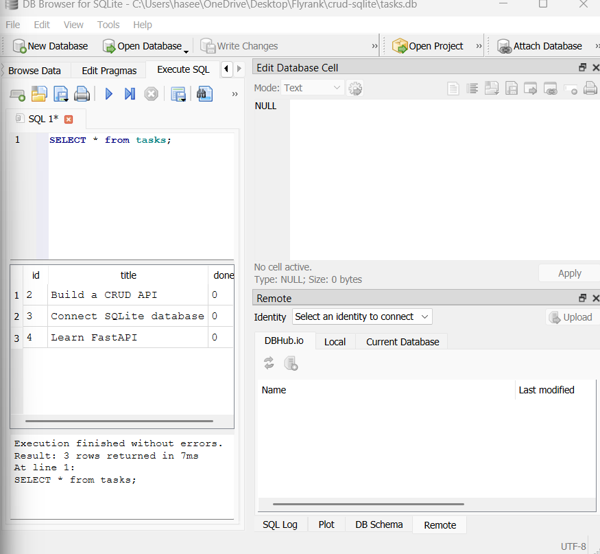

# SQLite CRUD API

A simple CRUD API built using Python, FastAPI, and SQLite. This project demonstrates how to create, read, update, and delete tasks using REST API endpoints and a persistent database.

## Technologies Used

- Python
- FastAPI
- SQLite
- Uvicorn
- DB Browser for SQLite

## Features

- View all tasks
- View a task by ID
- Create a new task
- Update an existing task
- Delete a task
- Store tasks persistently in SQLite

## Project Structure

```text
crud-sqlite/
├── main.py
├── tasks.db
├── README.md
└── .venv/  (virtual environment, if stored here)
```

## Database

The database is named `tasks.db` and is located in the same directory as `main.py`.

The `tasks` table contains:

| Column | Type | Description |
|---|---|---|
| id | INTEGER | Primary key, automatically generated |
| title | TEXT | Task title |
| done | BOOLEAN | Completion status |

The application creates the table if it does not exist. It inserts three example tasks only when the table is empty.

## API Endpoints

| Method | Endpoint | Description |
|---|---|---|
| GET | `/tasks` | Get all tasks |
| GET | `/tasks/{task_id}` | Get a task by ID |
| POST | `/tasks` | Create a task |
| PUT | `/tasks/{task_id}` | Update a task |
| DELETE | `/tasks/{task_id}` | Delete a task |

## Setup and Run

1. Install Python if it is not already installed.
2. Open a terminal in the project directory.
3. Install the dependencies:

   ```bash
   python -m pip install fastapi uvicorn
   ```

4. Start the application:

   ```bash
   python -m uvicorn main:app --reload
   ```

5. Open the interactive API documentation:

   http://127.0.0.1:8000/docs

## Example SQL Query

To retrieve all tasks:

```sql
SELECT * FROM tasks;
```

To retrieve completed tasks:

```sql
SELECT * FROM tasks WHERE done = 1;
```

To count all tasks:

```sql
SELECT COUNT(*) FROM tasks;
```

## Database Viewer

Open `tasks.db` using DB Browser for SQLite. Use the **Browse Data** tab to inspect the `tasks` table and the **Execute SQL** tab to run queries.

Add a screenshot of your database table here before submitting.

## Learning Outcome

This project demonstrates REST API development with FastAPI, SQLite database operations, parameterized SQL queries, and CRUD functionality.

## Screenshots


### Tasks Database



### SQL Query Results


